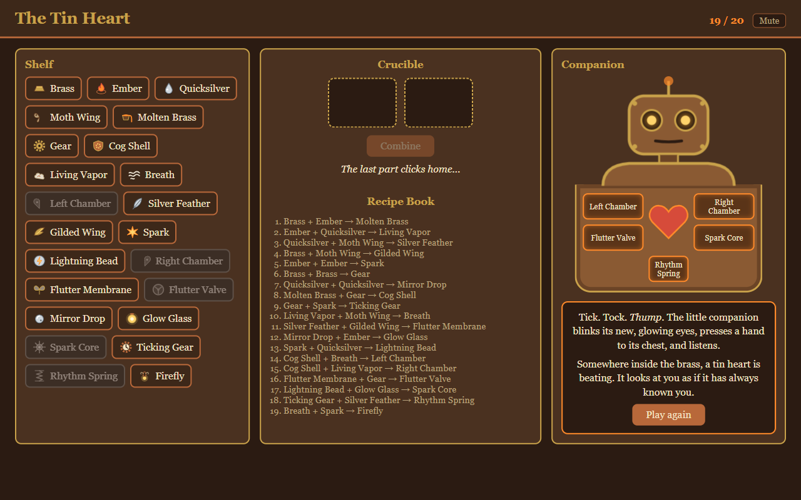
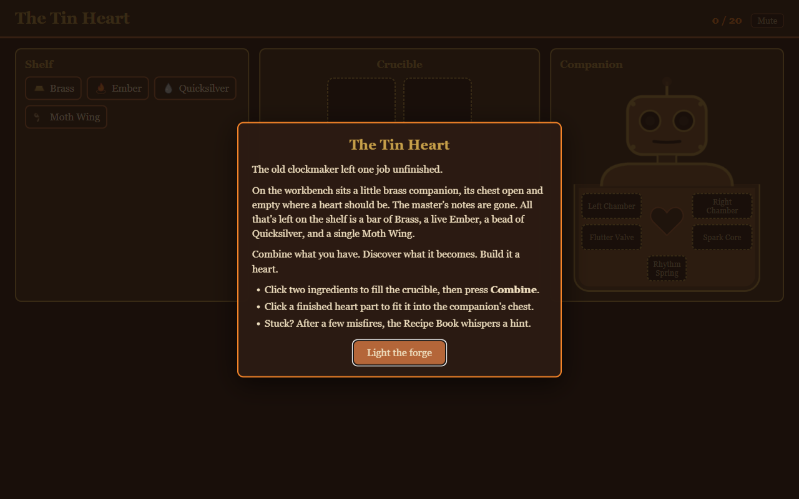
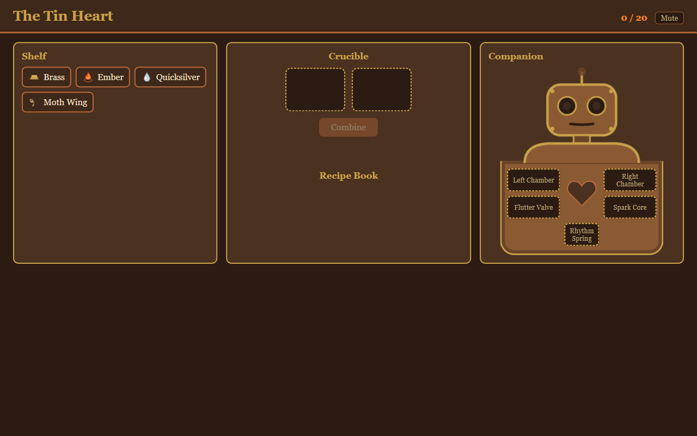
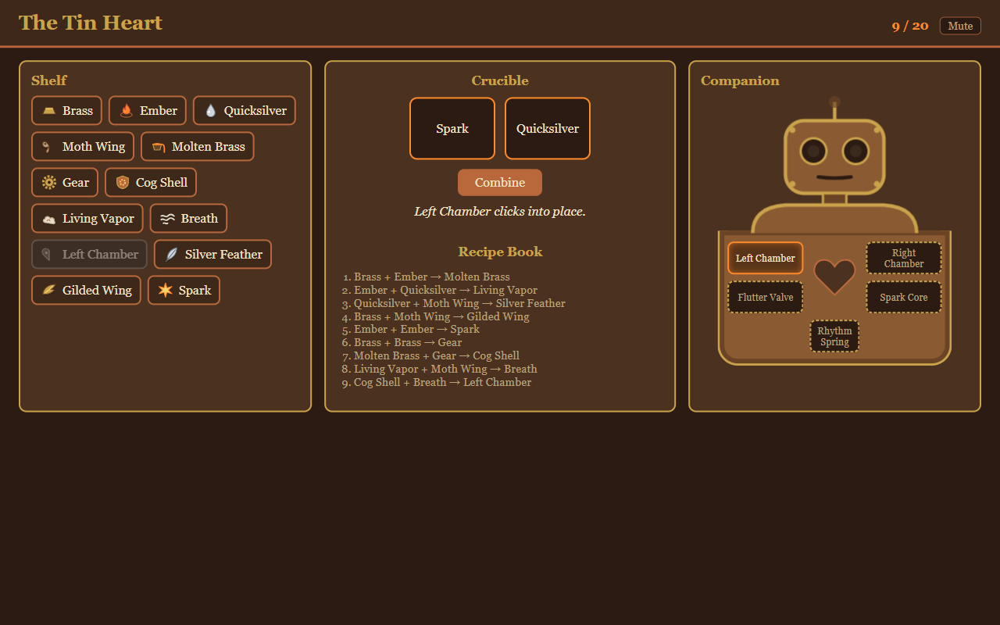
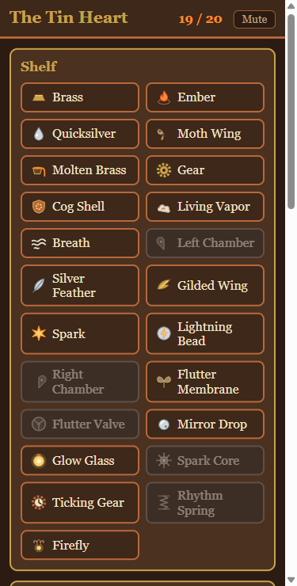

# The Tin Heart

A short, fanciful browser crafting game. A little brass companion sits on your
workbench without a heart. Combine odd ingredients (Brass, Ember, Quicksilver
and Moth Wing) in a crucible to discover 20 recipes and craft the five parts of
a tin heart. Install them in the companion's chest and watch the heart start
beating.



**Play it:** https://carleton200.github.io/Claude_code/

The whole game is one file, [`index.html`](index.html). It uses plain HTML,
CSS and JavaScript with inline SVG art and Web Audio sound. It has no build
step, no libraries and no network requests, so it also runs when opened
straight from disk.

## How to play



A new game opens with a short card that sets the scene: the old
clockmaker's unfinished companion, the four things left on the shelf, and
the basics below. Press **Light the forge** (or Escape) to close it and
start. The card shows only for a new game, on a first visit or after
**Play again**. Returning to a game in progress skips it.

1. **Pick two items.** Click an item on the **Shelf** and it drops into the
   first empty crucible slot. Click a second item to fill the other slot
   (click the same item twice to combine it with itself). If both slots are
   full, a new click replaces the second one. Click a filled slot to empty
   it. You can also drag an item onto either slot.
2. **Press Combine.** If the pair is a recipe, a new item appears on the
   Shelf and the recipe is written in the **Recipe Book**. If it isn't, the
   crucible puffs smoke. Items are never used up, order doesn't matter, and
   you can combine an item with itself.
3. **Stuck?** After three duds in a row, a hint appears that points toward a
   useful recipe.
4. **Build the heart.** Craft the Left Chamber, Right Chamber, Flutter Valve,
   Spark Core and Rhythm Spring. Click a finished part once and it clicks
   into its socket in the companion's chest. You can also drag it onto a
   socket, where a wrong part is rejected with a shake.
5. **Bring it to life.** When all five parts are installed, the heart thumps
   and the companion's eyes light up.





On a phone the panels stack into one column:



Progress saves automatically in your browser. **Play again** starts over.
Use the **Mute** button in the header to turn sound off or back on. Animations are
switched off when your system asks for reduced motion.

## Running the tests

The game is covered by a [Playwright](https://playwright.dev/) suite in
[`tests/`](tests/). It checks the recipe graph, the pure game logic and
persistence, the shelf, crucible, recipe book and hints, installing parts, a
full playthrough to the ending, reloads, blocked storage, drag-and-drop,
phone-width layout, `file://` loading and the opening card.

```bash
npm install
npx playwright install chromium
npm test
```

`npm test` starts a small zero-dependency static server
([`tests/server.mjs`](tests/server.mjs)) on port 4173 and runs every spec in
headless Chromium.

## How it was built

This project is a demo of building a small, complete thing with
[Claude Code](https://claude.com/claude-code) and the
[Superpowers](https://github.com/obra/superpowers) skills workflow, with
Playwright as the safety net. Every step left a record in the repo:

1. **Brainstorm.** A short back-and-forth settled the idea, the audience and
   the scope: one session, one file, a beating heart at the end.
2. **Design.** The agreed design was written up as a spec:
   [`docs/superpowers/specs/2026-11-16-tin-heart-design.md`](docs/superpowers/specs/2026-11-16-tin-heart-design.md).
3. **Plan.** The spec was broken into six small, test-first tasks, each with
   exact files, interfaces and expected test results:
   [`docs/superpowers/plans/2026-11-16-tin-heart.md`](docs/superpowers/plans/2026-11-16-tin-heart.md).
4. **Subagent-driven build.** A controller session handed each task to a
   fresh implementer subagent. Every task was then reviewed against the spec
   and for code quality before the next one started, and review findings
   were fixed before moving on. The Playwright suite grew with each task,
   and screenshots were taken with the Playwright browser tool.

The full conversation, from the first idea to the last commit, is in
[`conversation-history.txt`](conversation-history.txt). The git history shows
one commit per task (plus review fixes).

## Publishing on GitHub Pages

1. Push the repo to GitHub.
2. Go to **Settings → Pages**.
3. Under **Build and deployment**, choose **Deploy from a branch**, then
   branch **`main`** and folder **`/ (root)`**, and save.
4. After a minute the game is live at
   https://carleton200.github.io/Claude_code/.

Because `index.html` sits at the repo root and uses only relative paths, no
other setup is needed.
